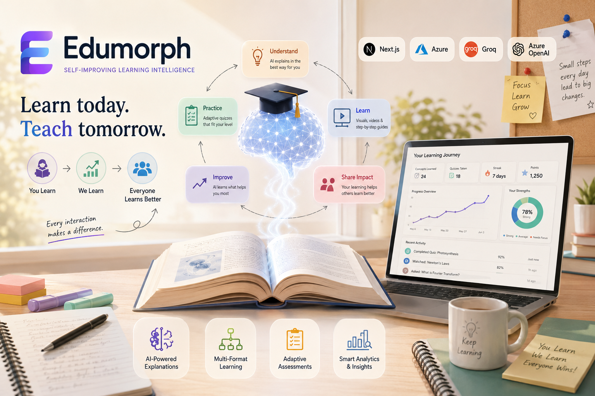

<div align="center">

# Edumorph

### Self-Improving Learning Intelligence Platform

> Every student who learns makes the next student's experience better — automatically.


<br/>



</div>

---

## What is Edumorph?

Edumorph is an AI-powered adaptive learning platform. A student pastes any concept or lecture text, and Edumorph instantly generates multiple teaching formats — analogies, step-by-step diagrams, explainer videos, and quizzes — tailored for how that concept is best understood.

What makes Edumorph different from a content generator is the **feedback loop**. Every interaction a student has — a quiz score, a video pause, a "make it simpler" click — is captured as a telemetry event, streamed into an Azure data pipeline, and analyzed to detect where learners consistently struggle. Azure OpenAI then generates targeted adaptation strategies. The next learner gets a better, smarter explanation — without any manual instructor intervention.

**The system learns from learners. Teaching improves automatically.**

---

## The Problem

Traditional digital learning platforms are static by design:

| Platform | How it adapts |
|---|---|
| Khan Academy | It doesn't — same video for everyone |
| Duolingo | Rule-based: if wrong, show easier content |
| Coursera | Instructor manually updates content every few months |

There is no system that closes the loop between **what students struggle with** and **how the explanation gets better** — in real time, at scale, without human intervention.

---

## How Edumorph Solves It

Edumorph is built around a closed feedback loop powered by Azure:

```
Input Concept
     │
     ▼
Content Generation (Groq / Llama 3.3 70B)
     │
     ├── Analogy
     ├── Step-by-Step Diagram
     ├── Explainer Video
     └── Adaptive Quiz
           │
           ▼
     Student Interacts
           │
           ▼
  Telemetry Events Captured
  (quiz score · video drop-off · feedback · regeneration clicks)
           │
           ▼
  Azure Event Hubs  ──▶  Azure Stream Analytics  ──▶  Azure Data Lake Gen2
                                                              │
                                                              ▼
                                                  Azure Synapse Analytics
                                                  (concept difficulty · format effectiveness)
                                                              │
                                                              ▼
                                                    Azure OpenAI (GPT-4o)
                                                  generates adaptation strategy
                                                              │
                                                              ▼
                                               Groq regenerates improved content
                                                              │
                                                              ▼
                                              Next learner gets a better explanation
```

---

## Architecture

### Layers

| Layer | Technology | Responsibility |
|---|---|---|
| Frontend | Next.js 14 App Router, React 18, TypeScript | UI, interaction capture, event batching |
| API | Next.js Route Handlers | Content generation, telemetry ingestion, analytics export |
| Event Streaming | Azure Event Hubs | Ingests 1000+ learning events/sec in real time |
| Processing | Azure Stream Analytics | Enriches and routes events |
| Storage | Azure Data Lake Gen2 | Petabyte-scale telemetry store, partitioned by date and concept |
| Analytics | Azure Synapse Analytics | SQL queries on difficulty, engagement, and format effectiveness |
| Adaptation | Azure OpenAI (GPT-4o) | Generates teaching improvement strategies from analytics insights |
| Content AI | Groq (Llama 3.3 70B) | Fast multi-format teaching content generation |

### Azure Services Used

- **Azure Event Hubs** — real-time event ingestion at scale
- **Azure Stream Analytics** — stateless event processing and routing
- **Azure Data Lake Gen2** — durable, queryable telemetry storage
- **Azure Synapse Analytics** — SQL-based learning behavior analysis
- **Azure OpenAI** — adaptive teaching recommendations

---

## Key Features

- **Multi-format generation** — one input, four teaching outputs (analogy, diagram, video, quiz)
- **Real-time telemetry** — every interaction streamed to Azure in under 1 second
- **Adaptive content** — AI-generated improvement strategies applied at regeneration time
- **Learning analytics dashboard** — concept difficulty, format effectiveness, engagement trends
- **Student progress tracking** — per-session performance and historical trends
- **Exportable datasets** — CSV and JSON exports for Power BI integration
- **Gamification layer** — streaks, badges, and points to sustain engagement

---

## Tech Stack

### Frontend
- Next.js 14 (App Router)
- React 18 · TypeScript · Tailwind CSS
- Zustand (state management)
- Recharts (analytics visualisation)

### AI
- Groq API — Llama 3.3 70B — primary content generation
- Azure OpenAI — GPT-4o — adaptive teaching strategies
- Zod — schema validation for all AI I/O

### Cloud & Data
- Azure Event Hubs · Azure Stream Analytics
- Azure Data Lake Gen2 · Azure Synapse Analytics
- Azure OpenAI Service

### Infrastructure
- Vercel (deployment)
- pnpm (package management)

---

## Getting Started

### Prerequisites

- Node.js 18+
- pnpm
- Groq API key ([console.groq.com](https://console.groq.com))
- Azure Event Hubs + Azure OpenAI resource

### 1. Clone and Install

```bash
git clone https://github.com/your-username/edumorph.git
cd edumorph
pnpm install
```

### 2. Configure Environment

Create `.env.local` in the project root:

```env
# Groq (required for content generation)
GROQ_API_KEY=your_groq_api_key

# Azure Event Hubs (required for telemetry)
AZURE_EVENTHUB_CONNECTION_STRING=your_connection_string
AZURE_EVENTHUB_NAME=edumorph-learning-events

# Azure OpenAI (required for adaptive teaching)
AZURE_OPENAI_ENDPOINT=https://your-resource.openai.azure.com/
AZURE_OPENAI_API_KEY=your_api_key
AZURE_OPENAI_DEPLOYMENT_NAME=gpt-4o
```

### 3. Run

```bash
pnpm dev
```

Open [http://localhost:3000](http://localhost:3000)

Check telemetry: [http://localhost:3000/api/telemetry](http://localhost:3000/api/telemetry)

---

## Project Structure

```
edumorph/
├── app/
│   ├── page.tsx                      # Landing page
│   ├── studio/page.tsx               # Teaching studio
│   ├── analytics/page.tsx            # Analytics dashboard
│   ├── student-dashboard/page.tsx    # Student view
│   └── api/
│       ├── generate/route.ts         # Content generation (Groq)
│       ├── generate/quiz/route.ts    # Quiz generation
│       ├── telemetry/route.ts        # Event ingestion (Azure)
│       ├── analytics/route.ts        # Analytics API
│       ├── student-analytics/route.ts
│       └── export-data/route.ts      # Dataset exports
├── components/
│   ├── InputCard.tsx                 # Lecture input
│   ├── ResultTabs.tsx                # Teaching format tabs
│   ├── ExplainerVideo.tsx            # Video + engagement telemetry
│   ├── QuizBlock.tsx                 # Quiz + score telemetry
│   ├── FeedbackBlock.tsx             # Feedback + telemetry
│   └── analytics/                   # Dashboard charts and widgets
├── lib/
│   ├── groq.ts                       # Groq API client
│   ├── telemetry.ts                  # Event schema and batcher
│   ├── schema.ts                     # Zod validation schemas
│   └── azure/
│       ├── eventHubs.ts              # Event Hubs client
│       └── adaptiveTeaching.ts       # Azure OpenAI integration
└── docs/
    ├── AZURE_ARCHITECTURE.md         # Full Azure documentation
    ├── QUICK_START.md                # Step-by-step Azure setup
    ├── synapse-queries.sql           # Analytics SQL queries
    └── POWERBI_SETUP.md             # BI dashboard setup
```

---

## API Reference

| Route | Method | Purpose |
|---|---|---|
| `/api/generate` | POST | Generate multi-format teaching content |
| `/api/generate/quiz` | POST | Generate adaptive quiz questions |
| `/api/telemetry` | POST / GET | Ingest events / health check |
| `/api/analytics` | GET | Retrieve aggregated learning analytics |
| `/api/student-analytics` | GET | Per-student performance data |
| `/api/export-data` | GET | Export datasets (CSV / JSON) |

---

## Documentation

| Document | Description |
|---|---|
| [Azure Architecture](docs/AZURE_ARCHITECTURE.md) | Complete technical architecture deep dive |
| [Quick Start Guide](docs/QUICK_START.md) | Full Azure resource setup in 30 minutes |
| [Synapse Queries](docs/synapse-queries.sql) | Analytics SQL for concept and engagement insights |
| [Power BI Setup](docs/POWERBI_SETUP.md) | Connect Synapse data to BI dashboards |

---

## License

MIT — see [LICENSE](LICENSE) for details.

---

<div align="center">
Built with Azure. Powered by learning data. Improved by every student.
</div>
